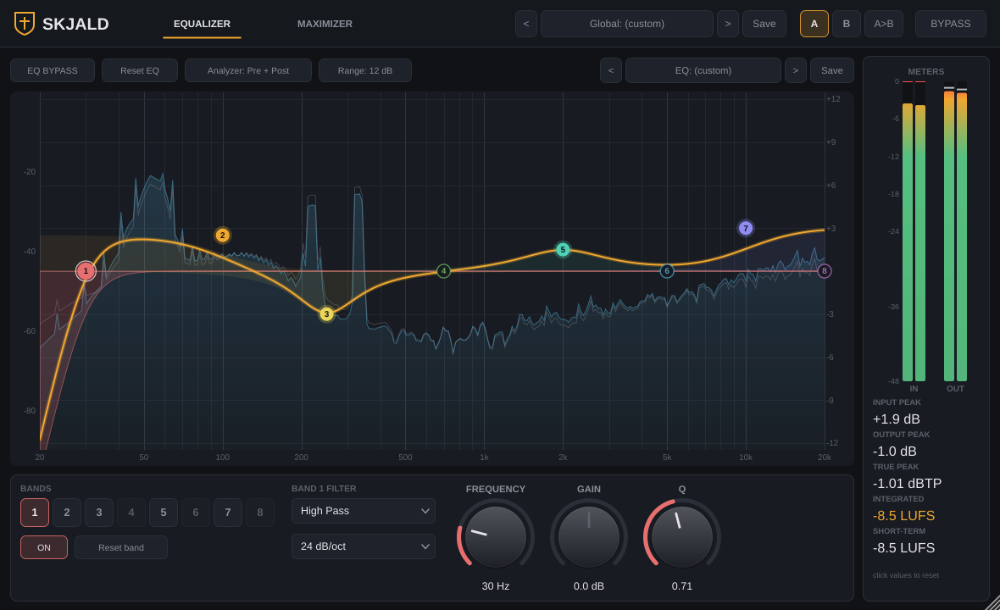
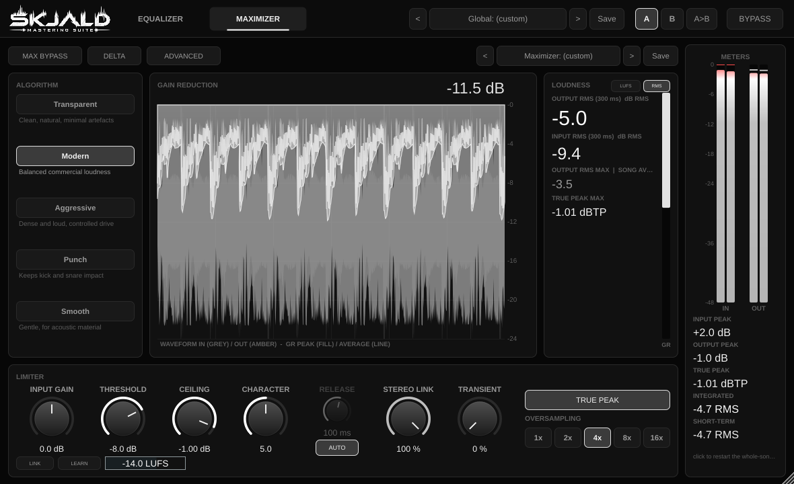

# SKJALD

A mastering plug-in (VST3) with two processors in one window:

| EQUALIZER | MAXIMIZER |
|---|---|
| 8-band parametric mastering EQ, matched (no cramping) filter design, bell / shelves / high-pass / low-pass / notch, 6-48 dB/oct, interactive graph with pre/post spectrum analyzer | True-peak lookahead limiter with five structurally different algorithms (Transparent, Modern, Aggressive, Punch, Smooth), 1x-16x oversampling, adaptive release, transient-selective clipping, stereo linking, delta monitoring, auto gain compensation |

Signal flow: **INPUT → EQUALIZER → MAXIMIZER → OUTPUT**, with independent EQ / Maximizer bypass and a latency-compensated global bypass. A global meter section (input / output peak, true peak, integrated and short-term LUFS per ITU-R BS.1770-4) is visible on both tabs.




## Platforms

- Windows 10/11 x64, VST3
- macOS 10.15+ universal binary (Apple Silicon + Intel), VST3
- Linux x86_64, VST3

Mono and stereo, 32- and 64-bit floating-point hosts, 44.1-192 kHz, any buffer size, full automation, state save/restore. Built with C++20, JUCE 8 and CMake.

## Quick start

```bash
git clone https://github.com/SacredHills/SKJALD.git
cd SKJALD
cmake -S . -B build -DCMAKE_BUILD_TYPE=Release
cmake --build build --config Release
ctest --test-dir build -C Release --output-on-failure
```

The VST3 is written to `build/Source/Plugin/SKJALD_artefacts/Release/VST3/SKJALD.vst3`.
Pre-built packages for all three platforms are produced by GitHub Actions (see the *Actions* tab, or *Releases* for tagged versions).

- [Build instructions](docs/BUILD.md)
- [Installation](docs/INSTALL.md)
- [Technical documentation](docs/TECHNICAL.md): DSP design decisions, measured tolerances, limitations
- [User guide](docs/USER_GUIDE.md)
- [Development log](docs/DEVLOG.md)

## Repository layout

```
Source/
  DSP/          pure C++20 DSP (no JUCE): Filters, Equalizer, Maximizer, Oversampling, Utilities
  Metering/     BS.1770 loudness, true-peak and sample-peak meters
  Engine/       MasteringEngine: the complete chain, shared by plug-in, tests and tools
  Plugin/       JUCE AudioProcessor / Editor, parameters, A/B
  Presets/      factory presets and the preset manager
  UI/           custom interface (tabs, EQ graph, analyzer, GR display, meters, look and feel)
Tests/
  DSP/          automated DSP tests (EQ, limiter, true peak, loudness, stereo, performance)
  Plugin/       host-level tests that load the built VST3
Tools/
  OfflineProcessor/  skjald_offline: WAV in -> WAV out + JSON report, CPU benchmark
  UIPreview/         headless editor renderer (development)
scripts/        independent Python verification (true peak / LUFS) and test-signal generator
```

## Testing

- `skjald_dsp_tests`: 45 tests / ~1230 checks: EQ accuracy, Q, slopes, stability over the whole parameter space, ceiling enforcement for every mode and oversampling factor, true peak against an independent reconstruction and the ITU-R BS.1770-4 reference meter (including full-band clipped noise), latency, algorithm differentiation, release / adaptive release, transient preservation, stereo link, delta, bypass, AGC, click-free parameter and oversampling changes, block-size invariance, EBU Tech 3341 loudness cases, CPU.
- `skjald_plugin_tests`: loads the built VST3 like a DAW: latency at every sample rate, impulse alignment, mono, random block sizes, 64-bit, state round-trip of all parameters, random automation, CPU, editor.
- [pluginval](https://github.com/Tracktion/pluginval) at strictness level 10 (CI, all platforms).
- `scripts/verify_true_peak.py`: independent (numpy/scipy) true-peak and LUFS measurement of files processed by `skjald_offline` (CI, Linux).

## Licensing

SKJALD is built on [JUCE 8](https://juce.com), which is dual-licensed (AGPLv3 or a commercial JUCE licence), and uses the Steinberg VST3 SDK bundled with JUCE. Distributing SKJALD binaries requires complying with one of the JUCE licence options (for a closed-source product: a JUCE Starter/Indie/Pro licence; otherwise the project must be released under the AGPLv3). VST is a trademark of Steinberg Media Technologies GmbH. No licence file has been chosen for this repository yet: that decision belongs to the owner.

The DSP in this repository is original work; it does not use code or algorithms copied from commercial plug-ins.
